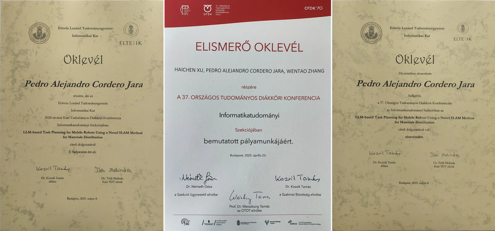
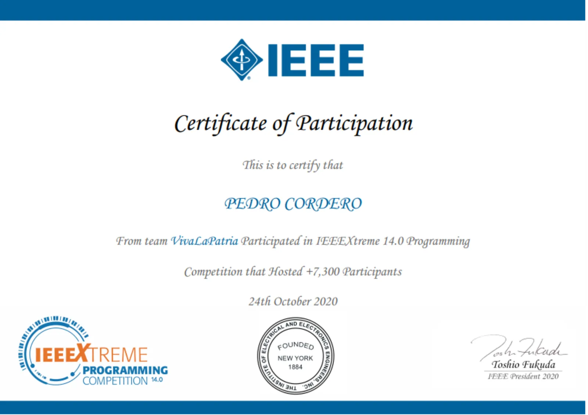

## 37th National OTDK Conference · 2025

Presented my thesis research at Hungary's largest student research conference (OTDK), in the Computer Science section, representing the ELTE Faculty of Informatics, and was commended by the Dean for this participation. The paper had won 1st prize at the faculty's TDK conference in December 2024.

## IEEEXtreme 14.0 Programming Competition · 2020

Took part with team VivaLaPatria in IEEEXtreme 14.0, a programming competition with more than 7,300 participants.

