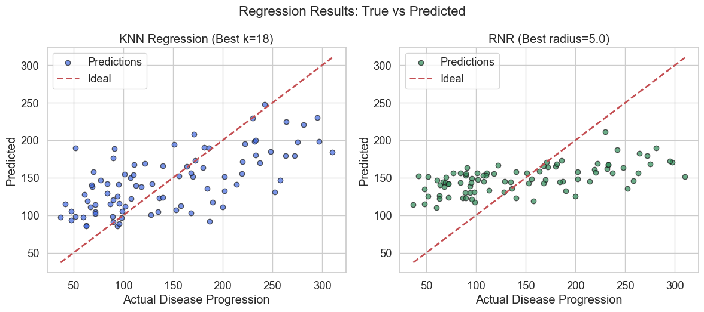
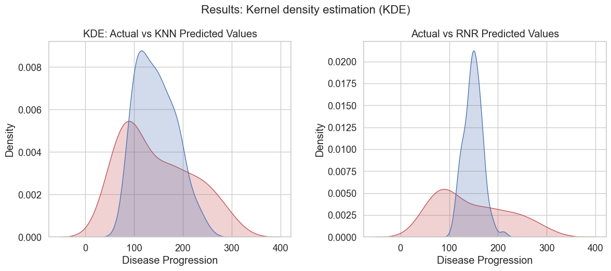

This project applies lazy learning algorithms, specifically K-Nearest Neighbors (kNN) and the Radius Neighbors Regressor (RNR), to predict diabetes disease progression from a real-world dataset. The dataset contains 10 clinical features including blood pressure, body mass index (BMI) and serum measurements. Cross-validation and hyperparameter tuning are used to maximize model performance.

## Key features

- Real-world medical dataset (Diabetes).
- Full feature utilization (10 clinical predictors).
- Feature standardization (important for distance-based models).
- Hyperparameter tuning with GridSearchCV.
- Model evaluation with MSE and R² score.

## Results

| Model | Best parameter | R² score | MSE |
|-------|----------------|----------|-----|
| KNN   | k = 18         | 0.42     | 3058 |
| RNR   | radius = 5.0   | 0.24     | 4035 |

- With all 10 features, KNN significantly outperforms RNR.
- Radius Neighbors is less stable unless tuned with large radii.
- Standardization is essential for distance-based learning.
- R² = 0.42 is a decent result for non-parametric models on noisy, real-world health data. It shows the model is extracting some structure, but more sophisticated models (like Random Forest or XGBoost) could do better.

*Regression results: true vs predicted.*

*Results: kernel density estimation (KDE).*
