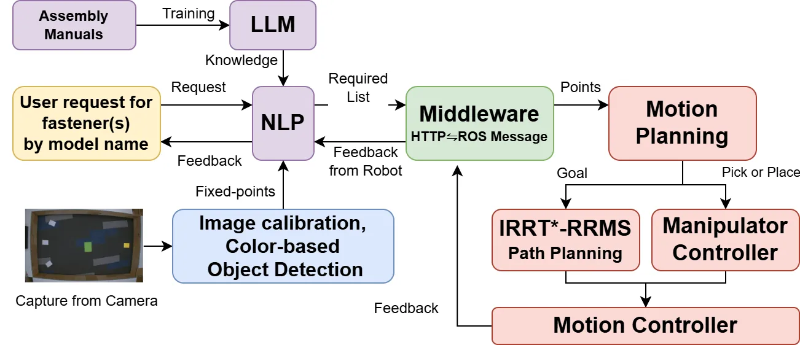
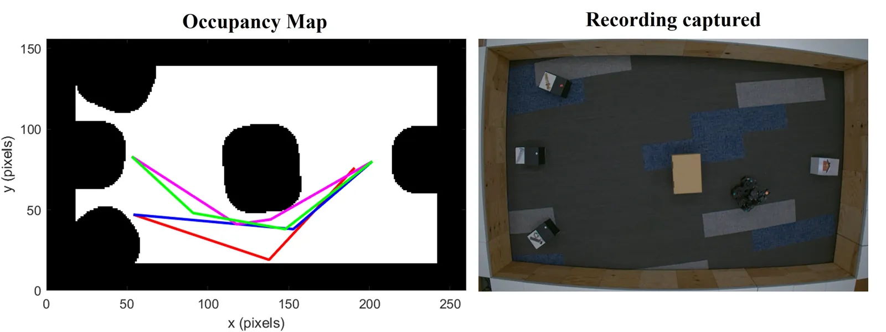
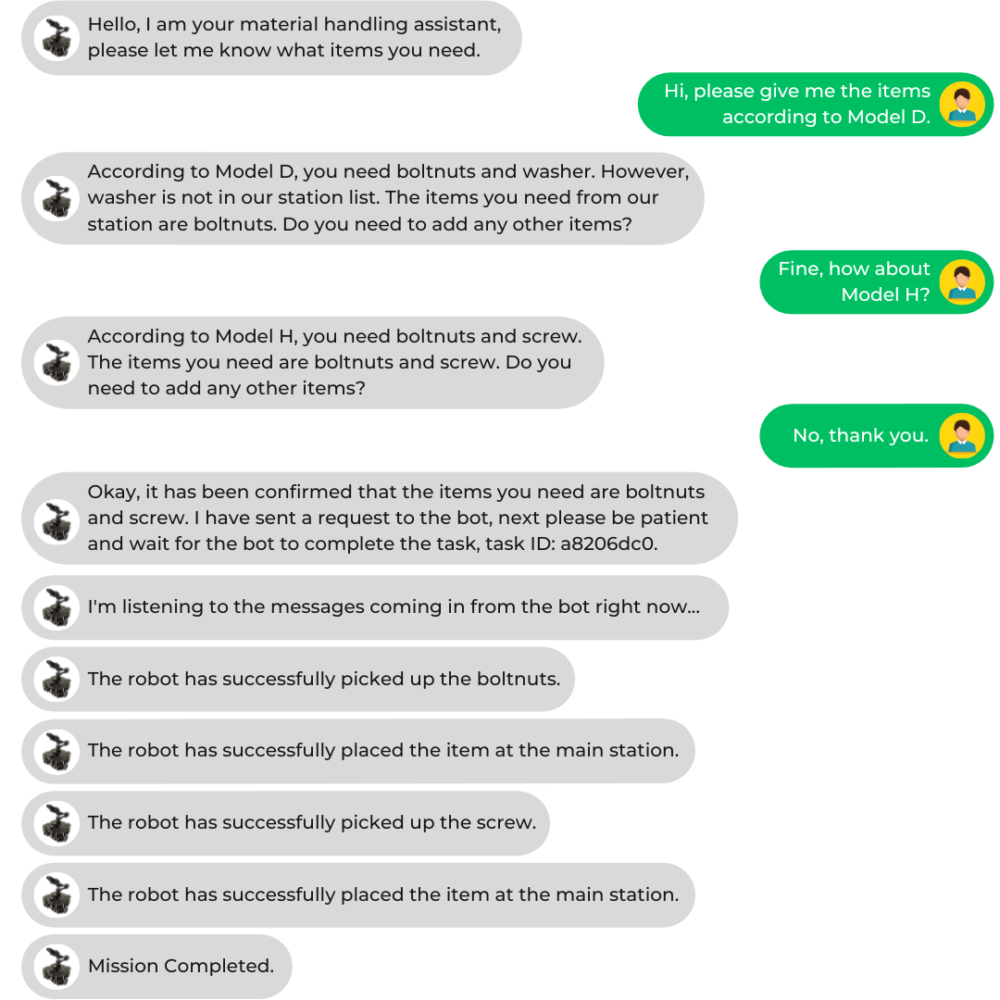

This work introduces an integrated autonomous mobile robot system for real-time material distribution in factory environments. By combining natural language processing for task interpretation, top-view color-based object detection for map creation, and the IRRT\*-RRMS algorithm for path planning, the system enables flexible and scalable operation without relying on traditional navigation methods.

## Key features

- **Collision-free navigation:** ensures safe multi-robot movement using the Right-of-Way (RoW) rule.
- **Top-view mapping:** uses fisheye images and color-based object detection to create occupancy maps for navigation.
- **Natural language processing:** integrates NLP and LLMs to interpret user commands and assembly instructions.
- **Novel SLAM mapping:** generates maps faster, without conventional SLAM techniques.
- **Advanced path planning:** uses IRRT\*-RRMS for efficient and adaptive motion control in real environments.

## System overview



```text
Partial prompt of LLM1
 1: <instruction>
 2:   You are a material handling assistant. Your task is to accept user requests for items and send them to the next component.
 3: </instruction>
 4: <stations>
 5:   {{#context#}}
 6: </stations>
 7: <instructions>
 8:    Step 1: If <stations/> is empty:
 9:        Sorry, no station information is available. Please try later.
10:   Step 2: When the user inputs items, check if they exist in the station list. The main station cannot be requested.
11:     - If all items exist:
12:       Okay, the items you need are {list of existing items}. Do you need any more items?
13:     - If some items do not exist:
14:       Sorry, {list of non-existing items} do not exist. The items you need are {list of existing items}. Do you need any more items?
15:   Step 3: Repeat Step 2 until the user does not want more items.
16:     - If no more items are needed:
17:       Okay, the final items you need are {final item list}.
18: </instructions>
```

## Results

Tested on a TurtleBot3 Waffle Pi with OpenManipulator-X, the system successfully executed material distribution for complex assembly scenarios (e.g. bolts, nuts and screws in model H), demonstrating reliable performance and adaptability in dynamic industrial settings.



*Model H sample: optimized routes performed.*



*Exported chat history.*

For more details, read the [paper on IEEE Xplore](https://ieeexplore.ieee.org/document/10977631).
