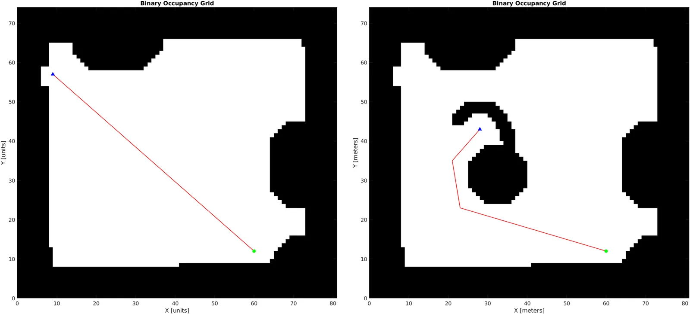

This research introduces the Improved RRT\* with Reduced Random Map Size (IRRT\*-RRMS), combined with the Right-of-Way (RoW) rule for efficient multi-robot path planning. The RoW rule enhances local navigation by integrating a virtual obstacle shape, guiding robots to avoid unknown obstacles while prioritizing right-side paths for optimized collision-free motion.

## Key features

- **Collision-free navigation:** ensures safe multi-robot movement using the RoW rule.
- **Virtual obstacle integration:** enhances obstacle avoidance in dynamic environments.
- **Optimized path planning:** post-processing with Bacterial Mutation and Node Deletion improves path efficiency.
- **Real-robot implementation:** validated in three scenarios: head-on navigation, static obstacle avoidance and dynamic obstacle avoidance.

## Pseudo-algorithm: virtual obstacles

```text
Algorithm VirtualObstacleAdding()
 1:  if Unknown Obstacle Detected then
 2:      Wait for 5 seconds
 3:      if Dynamic Unknown Obstacle then
 4:          Continue Motion
 5:      else
 6:          Static Unknown Obstacle
 7:          Subscribe a current position and orientation (xc, yc) and θ
 8:          Determine a distance to an obstacle as r
 9:          Create a Virtual Obstacle
10:          Add a virtual circle with radius R at (xc + r ⋅ cosθ, yc + r ⋅ sinθ)
11:          Add Virtual Line with Length of d
12:          Add Virtual Half-ring with Radius R
             at (xc + r ⋅ cos(θ + π), yc + r ⋅ sin(θ + π))
13:          Do the new path planning
14:      end if
15:      Do the motion
16:  end if
```

## Results

The proposed method achieves collision-free multi-robot path planning with optimal path selection. It adapts efficiently to dynamic environments and was tested on real mobile robots, proving its effectiveness in practical scenarios.



*Robot 1's local path solution after a head-on situation with no obstacles.*

For more details, read the [paper in the ACM Digital Library](https://dl.acm.org/doi/10.1145/3702468.3702470).
