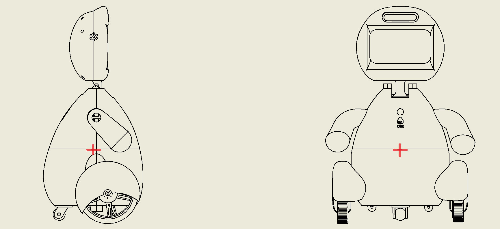
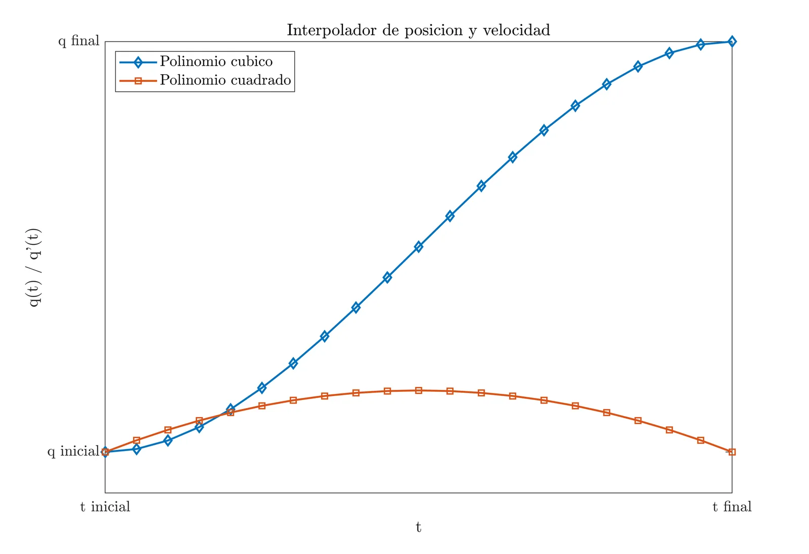
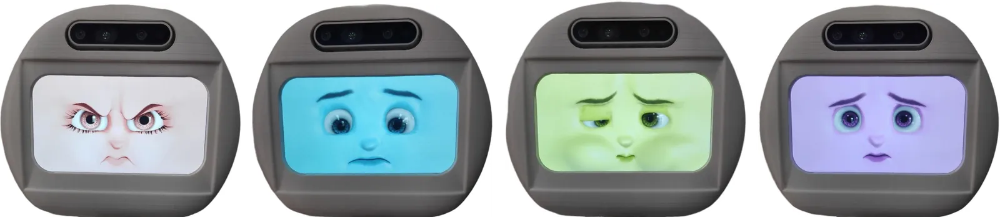

This research presents the design and evaluation of a robotic assistant aimed at improving emotional learning in individuals with Autism Spectrum Disorder (ASD). The robot was developed to simulate human-like emotions through facial expressions, colors, sounds and movement, assisting in therapeutic interventions.

<video src="/media/obi-asd-robot/emotions.mp4" autoplay loop muted playsinline></video>

## Key features

- **Emotion simulation system:** a facial screen capable of displaying six basic emotions (happiness, sadness, anger, fear, surprise and disgust), along with a neutral state.
- **Multimodal expression:** emotions are conveyed through visual (LED-based facial expressions), auditory (predefined sounds) and motion (body gestures) cues.
- **3D-printed mobile structure:** a compact design with arms, a wheeled base and a customizable 3D-printed body.
- **Expert validation process:** evaluated by five ASD specialists and 36 practitioners working with individuals with ASD.

## Evaluation and results

- **Appearance evaluation:** experts showed substantial agreement on the robot's design suitability (κ = 0.61).
- **Emotion recognition agreement:** only slight agreement (κ = 0.14) on the effectiveness of the robot's emotion display.
- **Therapeutic usability feedback:** 78% of practitioners found the robot useful for emotional learning exercises.
- **Future refinements identified:** emotion expressiveness needs further improvement before direct trials with individuals with ASD.
- **Replicable evaluation framework:** a structured method for validating assistive robots before deployment in therapy settings.

*Design and center of gravity of the robotic assistant (front and side view).*

*Trajectory generation through a position and velocity interpolator.*

*Emotional states of the robotic assistant (male and female character).*

<video src="/media/obi-asd-robot/disassembly.mp4" autoplay loop muted playsinline></video>

*Robot hardware disassembly (simulation).*

For more details, read the [paper in the International Journal of Social Robotics](https://link.springer.com/article/10.1007/s12369-024-01145-x).
