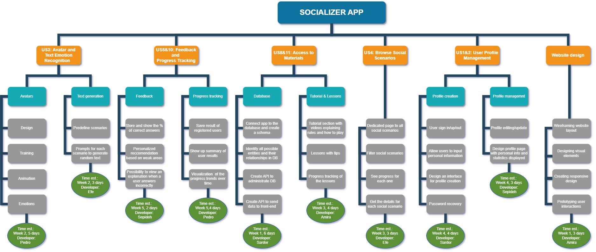

Socializer is an AI-powered platform designed to help individuals with autism improve their emotional recognition skills. Using AI-generated avatars and scenarios, Socializer creates immersive learning experiences that enhance users' ability to interpret emotions in real-life social interactions.

**My role:** this was a team project. I developed the volumetric head avatars with PyTorch.

## Key features

- **AI-generated avatars:** realistic, dynamically created social interactions powered by PyTorch.
- **Personalized learning paths:** adaptive exercises tailored to individual progress and learning styles.
- **Progress tracking:** users receive feedback on their performance to help them understand their mistakes.

## Results: KPIs

| KPI | Description | Formula | Target | Actual | Comments |
|-----|-------------|---------|--------|--------|----------|
| Project progress | Monitor the completion rate of tasks assigned to team members to ensure progress according to the project timeline | pp += 1 for every task finished before the deadline | 5 | 19 | Calculated based on the work breakdown structure. Each task weighted one point. |
| Session participation | Ensure regular attendance and active participation in team meetings to discuss progress, challenges and next steps | sp = 20 × n, n = people present / team members | 20 | 88.9 | 9 meetings in total without the coach. All members took part in 6 of them, 4 people in 1 and 3 people in 2: (6×5 + 1×4 + 2×3) / 9 is the average number of people per meeting. |
| Creativity and innovation | Encourage the exploration and implementation of innovative features or ideas within the project to enhance its functionality or appeal | ci += 1 × n, n = ideas judged creative / extra effort performed | 5 | 2 | The project has a very good social impact but lacks innovative ideas. |
| Team satisfaction and collaboration | Collect feedback from team members about their satisfaction with the project, team dynamics and overall collaboration | tsc = sum(f) / 5, f = each member's satisfaction (1 to 5) | 5 | 5 | Feedback was collected from each team member. |

<video src="/media/socializer/avatar.mp4" autoplay loop muted playsinline></video>

*INSTA (Instant Volumetric Head Avatars, PyTorch) sample.*
