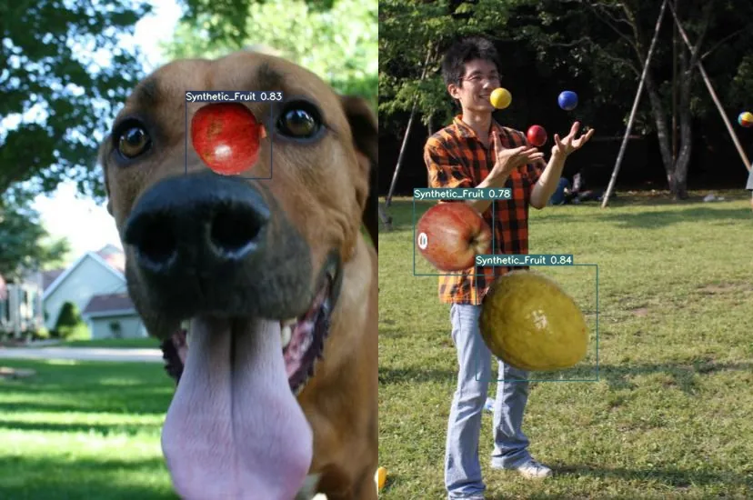
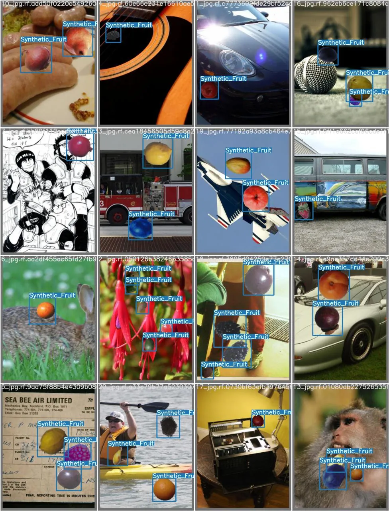
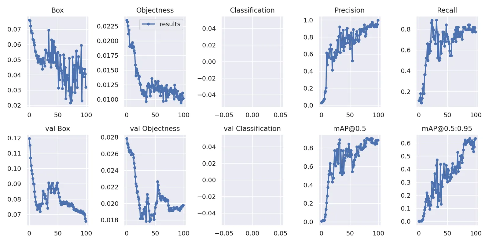

This project trains and evaluates an object detection model using YOLOv7. The model is trained on a dataset to detect objects effectively, and its performance is analyzed with loss values, precision, recall and mean average precision (mAP). The results are visualized to understand the model's learning progress over time.

## Key features

- **YOLOv7-based object detection:** uses the YOLOv7 architecture for fast and accurate object detection.
- **Model training and validation:** tracks training and validation losses, including box, objectness and classification loss.
- **Performance metrics:** evaluates precision, recall and mean average precision (mAP@0.5 and mAP@0.5:0.95) to measure detection accuracy.
- **Visualization of learning progress:** plots loss reduction and performance improvements over training epochs.

## Results

The YOLOv7 model showed strong object detection performance, with precision and recall increasing throughout training. The mAP@0.5 exceeded 60%, indicating reliable detection accuracy. The validation loss decreased significantly, confirming effective learning. The results suggest the model is well suited for object detection tasks, and further fine-tuning could improve performance even more.

*YOLOv7 training results: loss reduction and performance metrics over epochs.*
